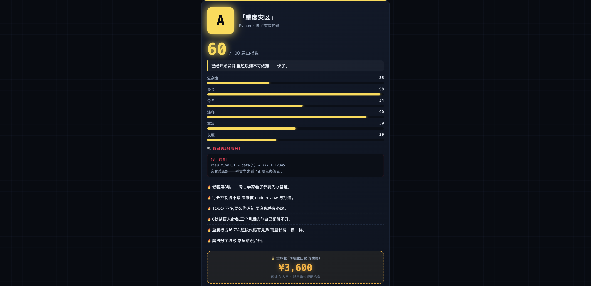

# 💩 屎山代码鉴定所 SHITSCAN

> 粘贴代码 → 3 秒出「屎山等级证书」→ 甩到群里让作者社死



**SHITSCAN** 是一个零依赖的单文件代码娱乐鉴定工具：把那段你不敢动的祖传代码贴进来，3 秒生成屎山指数、六维分析、罪证现场和重构报价单，一键导出 750×1334 战报海报——每一次转发都是产品的广告位。

## ✨ 特性

- **六维鉴定**：复杂度 / 嵌套 / 命名 / 注释 / 重复 / 长度，加权算出屎山指数（0-100）
- **六级称号**：D 崭新出厂 → C 微瑕之作 → B 初具山形 → A 重度灾区 → S 镇店屎山 → SS 万年圣山 → SSS 代码成精
- **罪证现场**：定位最深嵌套、超长行、TODO 铁证、被静默吞掉的异常，逐条毒舌点评
- **重构报价**：按人日 × 时薪折算「老板欠你多少钱」，数字越离谱转发越起劲
- **战报海报**：Canvas 生成 750×1334 分享图，带唯一证书编号
- **屎山榜**：全站 TOP10 仅记录等级指标，供后来者瞻仰
- **隐私即卖点**：代码只在服务器内存鉴定，即用即焚，落盘的只有分数指标
- **零依赖**：纯 Python 标准库，`python3 app.py` 一条命令跑起来

## 🚀 快速开始

```bash
git clone https://github.com/tomlen045/shitscan.git
cd shitscan
python3 app.py
# 打开 http://127.0.0.1:8670
```

支持 Python / JavaScript / Java / Go / C 五种语言的自动识别（也可手动指定）。

## 🔒 隐私说明

- 粘贴的代码**只存在于鉴定请求的内存中**，用完即焚，不写磁盘、不打日志
- 服务端只持久化：等级、分数、语言、行数、报价等**指标字段**，用于总数统计与排行榜
- 仍然建议：别贴含密钥/密码的代码（虽然贴了也没存）

## ⚠️ 免责声明

本工具鉴定结果纯属娱乐，不构成任何代码质量评审意见。
如与作者实际技术水平雷同，纯属巧合——大概吧。

## 📄 License

[MIT](LICENSE)
